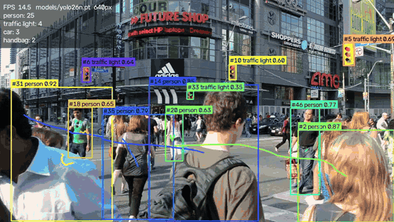
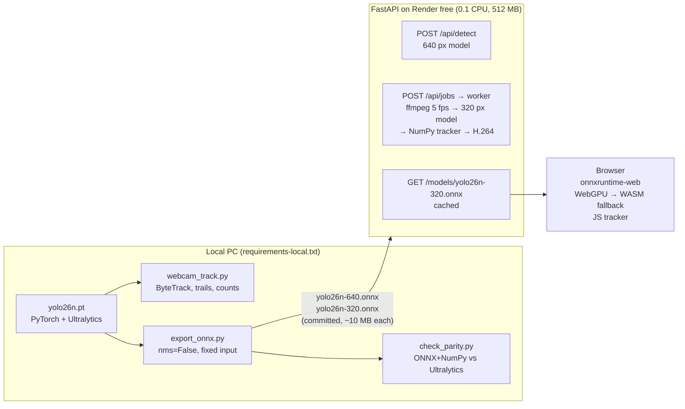

# VisionTrack: Real-Time Object Detection & Tracking

Detect and track 80 kinds of everyday objects (people, cars, bikes, dogs, phones…) in **images**, **short videos** and **live on your webcam**, with an Ultralytics **YOLO26n** model.

The same trained network runs in three places, each picked for where it fits best:

| Where | Runtime | What it does |
|---|---|---|
| **Your PC** (local scripts) | PyTorch + Ultralytics | Real-time webcam detection with ByteTrack tracking, trails and line-crossing counts; ONNX export; parity checks |
| **Server** (FastAPI on Render free tier) | ONNX Runtime + NumPy, **no PyTorch** | Image endpoint, and a short-video background job with a NumPy SORT-style tracker and H.264 output |
| **Your browser** | ONNX Runtime Web (WebGPU / WASM) | Live webcam detection + tracking at ~20 FPS, zero server CPU, no video leaves the device |



*Local run of [`scripts/webcam_track.py`](scripts/webcam_track.py) (PyTorch, ByteTrack) on the sample clip.*

**Skills covered:** object detection, multi-object tracking (ByteTrack and a hand-written SORT-style tracker), video processing with ffmpeg, model export/optimization (PyTorch → ONNX, NMS-free head, two input sizes), deployment trade-offs (server CPU vs. in-browser WebGPU).

## Architecture



```
Video job:  upload ─► ffprobe (length, rotation) ─► ffmpeg: sample 5 fps, scale ≤ 640 px, raw BGR pipe
                 ─► per frame: letterbox → ONNX (320) → filter → un-letterbox → tracker.update → draw
                 ─► ffmpeg pipe: libx264 yuv420p +faststart ─► annotated MP4 + unique counts per class
```

### Why ONNX instead of PyTorch on the server

Render's free tier has **512 MB RAM and 0.1 CPU**. PyTorch + Ultralytics alone is well over a gigabyte installed and several hundred MB in memory before a model loads. Exporting to ONNX keeps the server to `onnxruntime`, `numpy` and `opencv-python-headless`:

- **Image:** ~640 MB unpacked (303 MB compressed), with a static ffmpeg build instead of Debian's ~450 MB package.
- **Memory:** **~150 MB idle and ~306 MB peak** while processing a video job, measured with `docker run --memory 512m --cpus 0.1`.
- **Pre/post-processing** is plain NumPy ([`app/detector.py`](app/detector.py)). It is verified to match Ultralytics exactly (IoU 1.000, confidence diff 0.000) by [`scripts/check_parity.py`](scripts/check_parity.py).

### Export choices

- **NMS-free head.** YOLO26 has an end-to-end, one-to-one head. Exported with `nms=False`, the graph outputs `(1, 300, 6)` final detections `[x1, y1, x2, y2, score, class]`, so post-processing is just a confidence filter and un-letterboxing, in Python and in JavaScript. The decoder also handles the raw `(1, 84, N)` head (e.g. YOLO11) with a class-aware NumPy NMS, which the tests cover.
- **Two fixed input sizes, same weights.** 640 px for single images (accuracy matters, one inference) and 320 px for video and the browser (~4× fewer pixels, so it runs on 0.1 CPU and at real-time rates in a browser).
- **Fixed shapes** (`dynamic=False`, simplified with onnxslim) run fastest in onnxruntime-web.

### Tracking

- **Local:** Ultralytics' built-in **ByteTrack** at full frame rate.
- **Server and browser:** a small **SORT-style tracker** written from scratch ([`app/tracker.py`](app/tracker.py), mirrored in [`static/live.js`](static/live.js)):
  - Constant-velocity motion model: a smoothed per-frame box delta, a lightweight stand-in for SORT's Kalman filter.
  - Greedy IoU matching within the same class.
  - A track gets an ID only after `min_hits` matches, so one-frame false positives are never counted.
  - Tracks coast through short occlusions for `max_age` frames.
- "Unique objects" counts confirmed track IDs. Over-segmentation (one object getting two IDs after a long occlusion) is the main source of over-counting.

## Measured performance

| Setup | Model | Result |
|---|---|---|
| Local, Ryzen 5 4500U laptop, PyTorch CPU | YOLO26n 640 + ByteTrack | ~10–15 FPS (`webcam_track.py`) |
| Local, ONNX Runtime, 1 thread | YOLO26n 640 | ~140 ms per image |
| Docker, `--cpus 0.1 --memory 512m` (Render free) | YOLO26n 640 | ~2 s per image request (warm) |
| Docker, `--cpus 0.1 --memory 512m` | YOLO26n 320 + NumPy tracker | 12 s clip (60 frames at 5 fps) in ~50 s |
| Chrome, WebGPU (laptop iGPU) | YOLO26n 320 in onnxruntime-web | ~20 FPS, ~43 ms per frame |

## Run locally

Requires Python 3.12+ and [ffmpeg](https://ffmpeg.org/) on PATH (Windows: `winget install Gyan.FFmpeg`).

```bash
python -m venv .venv
.venv\Scripts\activate          # Windows  (macOS/Linux: source .venv/bin/activate)

# PyTorch/Ultralytics side (CPU torch, large download)
pip install -r requirements-local.txt --extra-index-url https://download.pytorch.org/whl/cpu
python scripts/webcam_track.py                  # webcam; q quits, r resets counts
python scripts/webcam_track.py --source samples/crosswalk.mp4 --line 0.6 --save out.mp4

# Re-export the ONNX models (already committed in models/) and check parity
python scripts/export_onnx.py
python scripts/check_parity.py

# Web app + tests
pip install -r requirements-dev.txt
uvicorn app.main:app --reload    # http://localhost:8000 · API docs at /docs
pytest
```

The live webcam tab needs HTTPS or `localhost` (browser camera rule). The deployed app uses `requirements.txt` only: no PyTorch, no Ultralytics. Don't install it into the same venv as `requirements-local.txt`, because `opencv-python-headless` and `opencv-python` both provide `cv2`.

Or run the production image with the free-tier limits:

```bash
docker build -t visiontrack .
docker run --rm -p 8000:8000 --memory 512m --cpus 0.1 visiontrack
```

## API

| Method | Path | |
|---|---|---|
| `POST` | `/api/detect?conf=0.25` | multipart `file` (jpg/png/webp/bmp); returns `detections` (`class`, `confidence`, `box` xyxy), `counts`, `inference_ms`, and the annotated `image` as a JPEG data URL |
| `POST` | `/api/jobs` | multipart `file` (mp4/mov/webm/mkv/avi); returns `{id, status}` (202) |
| `GET` | `/api/jobs` | this session's video jobs |
| `GET` | `/api/jobs/{id}` | status, `progress`, then `counts` (unique objects per class), `frames`, `seconds` |
| `GET` | `/api/jobs/{id}/video` | annotated H.264 MP4 |
| `DELETE` | `/api/jobs/{id}` | remove a finished job |
| `GET` | `/models/yolo26n-320.onnx`, `/models/classes.json` | model files for the browser (cached for a day) |

`/api/jobs` calls need an `X-Session-Id` header (the UI generates a random one per browser).

## Privacy and public-demo limits

- **Live webcam frames never leave the browser.** Inference runs on your device.
- **Uploads are not kept.** Images are processed in memory. Videos go to a private temp dir: the upload is deleted after processing, and the annotated result is deleted after 30 minutes or when you remove it.
- No login: each browser only sees its own video jobs.
- **Images:** up to 8 MB and 40 MP. Larger images are downscaled to 1920 px.
- **Videos:** up to 15 s and 20 MB, sampled at 5 fps and downscaled to 640 px.
- **Rate limits:** one video job at a time per browser, 10 videos and 60 images per IP per hour.

## Deploy (Render free tier)

No API keys or environment variables are needed.

1. Push this repo to GitHub.
2. Render → **New → Blueprint** → pick the repo (uses [`render.yaml`](render.yaml)).
3. Wait for the Docker build. The health check is `/api/health`.

Free instances sleep after 15 minutes idle; the first request after that takes ~30–60 s to wake up.

## Project layout

```
app/        config.py · detector.py (ONNX + NumPy) · tracker.py · video.py (ffmpeg) · jobs.py · main.py
static/     index.html · style.css · app.js (image/video UI) · live.js (in-browser inference + tracker)
models/     yolo26n-640.onnx · yolo26n-320.onnx · classes.json
scripts/    webcam_track.py · export_onnx.py · check_parity.py
samples/    CC0 street image and clip (see samples/SOURCES.md)
tests/      pre/post-processing, NMS, tracker, API + video job end to end
```

## License

[AGPL-3.0](LICENSE). Ultralytics YOLO and its pretrained weights (and so the exported ONNX models in `models/`) are AGPL-3.0, so this project is too. Sample media is CC0 ([sources](samples/SOURCES.md)).
